  

<a href="README.md">Read in English</a>

**Construyo los pipelines, APIs y agentes de IA que convierten datos contables crudos en cifras con las que un equipo de finanzas sí puede decidir.**

Encargado de TI en **Olson Capital**, un grupo financiero mexicano. Ingeniería en Software y Sistemas Computacionales, Universidad La Salle Bajío (2026).

### Lo que construyo en el trabajo

El código es privado; los casos de estudio están en mi [portafolio](https://jesusalmanza.netlify.app/es/).

| Proyecto | Qué hace |
|:-:|---|
|  **MatchCount** | Agente de IA (Google Gemini + Python) que mapea las cuentas del ERP CONTPAQi a un data warehouse en PostgreSQL sobre Cloud SQL. Desarrollador único. |
|  **DashBI** | API REST de solo lectura en Django 5.2 detrás del dashboard financiero del grupo: estados de resultados consolidados, lógica de periodos fiscales y comparativos entre años. |

- **4,762** registros contables consolidados de dos empresas del grupo
- **791** pruebas de backend aprobadas con pytest
- **60** casos de prueba de QA validados contra el data warehouse en vivo
- **< 1 s** de latencia mediana por endpoint a lo largo de cinco sprints de Scrum

### Proyectos públicos

| Proyecto | Qué demuestra |
|:-:|---|
|  [**Nucleus**](https://github.com/JAlcon00/Nucleus) | Coach de fuerza nativo para iPhone y Apple Watch con una capa de IA agéntica. Swift/SwiftUI, más de 800 pruebas, CI, ADRs y pull requests ligados a Jira. |
|  **FILMAX** [API](https://github.com/JAlcon00/filmax-service-api) / [web](https://github.com/JAlcon00/filmax-client-web) | MVP en equipo con Scrum: API en Express + TypeScript + Prisma con JWT, Zod y rate limiting, y un cliente en Angular probado con Cypress. |
|  [**FarmaAPI**](https://github.com/JAlcon00/FarmaAPI) | API de gestión farmacéutica en Java 17 + Spring Boot 3, JWT y MySQL, con Docker, Terraform y GitHub Actions. |
|  [**GeoTurismoAPI**](https://github.com/JAlcon00/GeoTurismoAPI) | API de turismo georreferenciado: Express 5, TypeScript estricto, MongoDB, Zod, Jest + Supertest y documentación en Swagger. |
|  [**JesusAlmanzaCVWeb**](https://github.com/JAlcon00/JesusAlmanzaCVWeb) | Mi portafolio bilingüe: Astro, Tailwind CSS v4, islas de React y una visualización de datos en Three.js. |

### Stack

- **Lenguajes:** Python, TypeScript, Swift, Java, C#, SQL
- **Backend:** Django, Express, Spring Boot, .NET, APIs REST, pytest, Jest
- **Datos e IA:** PostgreSQL, SQL Server, MySQL, MongoDB, ETL, data warehousing, Gemini API
- **Nube y DevOps:** Google Cloud (Cloud SQL), AWS, Docker, Terraform, GitHub Actions
- **Frontend y móvil:** React, Angular, Astro, SwiftUI, Tailwind CSS

### Contacto

Encuéntrame en mi [portafolio](https://jesusalmanza.netlify.app/es/) y en [LinkedIn](https://www.linkedin.com/in/jesusalmanza), o escríbeme a c.jesusalmanza@gmail.com.
