  

<a href="README.es.md">Leer en español</a>

**I build the pipelines, APIs and AI agents that turn raw accounting data into numbers a finance team can actually decide with.**

IT Manager at **Olson Capital**, a Mexican financial group. B.Eng. in Software & Computer Systems, Universidad La Salle Bajío (2026).

### What I build at work

Private code; the case studies live on my [portfolio](https://jesusalmanza.netlify.app).

| Project | What it does |
|:-:|---|
|  **MatchCount** | AI agent (Google Gemini + Python) that maps CONTPAQi ERP accounts into a PostgreSQL data warehouse on Cloud SQL. Sole developer. |
|  **DashBI** | Django 5.2 read-only REST API behind the group's financial dashboard: consolidated income statements, fiscal-period logic and multi-year comparisons. |

- **4,762** accounting records consolidated from two group companies
- **791** backend tests passing with pytest
- **60** QA test cases validated against the live data warehouse
- **< 1 s** median endpoint latency across five Scrum sprints

### Public projects

| Project | What it shows |
|:-:|---|
|  [**Nucleus**](https://github.com/JAlcon00/Nucleus) | Native iPhone + Apple Watch strength coach with an agentic AI layer. Swift/SwiftUI, 800+ tests, CI, ADRs and Jira-linked pull requests. |
|  **FILMAX** [API](https://github.com/JAlcon00/filmax-service-api) / [web](https://github.com/JAlcon00/filmax-client-web) | Team MVP built under Scrum: Express + TypeScript + Prisma API with JWT, Zod and rate limiting, and an Angular client tested with Cypress. |
|  [**FarmaAPI**](https://github.com/JAlcon00/FarmaAPI) | Pharmacy management API in Java 17 + Spring Boot 3, JWT and MySQL, with Docker, Terraform and GitHub Actions. |
|  [**GeoTurismoAPI**](https://github.com/JAlcon00/GeoTurismoAPI) | Geo-referenced tourism API: Express 5, strict TypeScript, MongoDB, Zod, Jest + Supertest and Swagger docs. |
|  [**JesusAlmanzaCVWeb**](https://github.com/JAlcon00/JesusAlmanzaCVWeb) | My bilingual portfolio: Astro, Tailwind CSS v4, React islands and a Three.js data visualization. |

### Stack

- **Languages:** Python, TypeScript, Swift, Java, C#, SQL
- **Backend:** Django, Express, Spring Boot, .NET, REST APIs, pytest, Jest
- **Data & AI:** PostgreSQL, SQL Server, MySQL, MongoDB, ETL, data warehousing, Gemini API
- **Cloud & DevOps:** Google Cloud (Cloud SQL), AWS, Docker, Terraform, GitHub Actions
- **Frontend & mobile:** React, Angular, Astro, SwiftUI, Tailwind CSS

### Get in touch

Find me on my [portfolio](https://jesusalmanza.netlify.app) and [LinkedIn](https://www.linkedin.com/in/jesusalmanza), or write to c.jesusalmanza@gmail.com.
